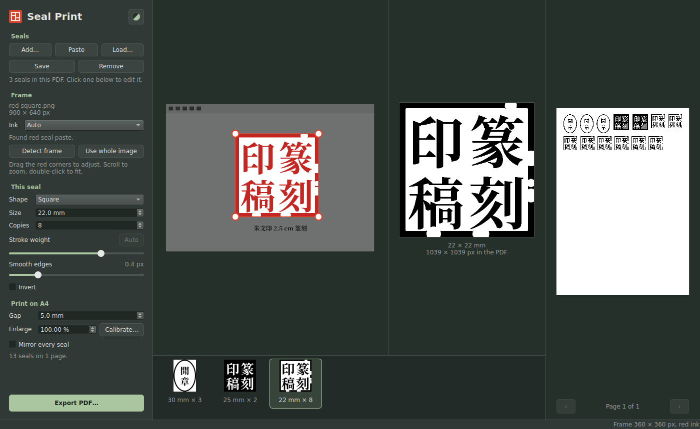

# Seal Print

Turn a scan, photo or screenshot of a Chinese seal (印章) into a pure black-and-white print at its exact
physical size on A4, ready to transfer onto a seal stone.



## What it does

- **Finds the seal by itself.** Rough screenshots are fine: extra margin, captions, a dark image-viewer
  background, a slight tilt, a chipped border, or the dashed outline of a free-form seal. If the frame
  is off, Crop manually lets you draw the seal's area yourself.
- **Pure black and white.** The PDF holds a lossless 1-bit image at 1200 dpi. Red seal paste is read
  separately from black calligraphy around it, and stroke weight and edge smoothing are adjustable.
- **Extra smooth.** For rough impressions, on the main page and in builds: redraws every outline as
  clean curves, a best guess at the intended strokes. Specks and pinholes go, ragged edges come out
  straight or evenly curved, and real corners stay sharp.
- **Square seals and other shapes.** Rectangles, ovals, circles and free-form seals keep their
  proportions and are sized by their longest length.
- **Many seals on one sheet.** Each seal has its own size and number of copies, and everything is packed
  onto as few A4 pages as possible.
- **Exact size, even on stubborn printers.** For self-service printers that always shrink pages to fit,
  the Enlarge setting compensates, and Calibrate works out the number from a test print.
- **Close-up inspection.** Click the black-and-white seal to zoom into the exact pixels that get printed.
- **Seal library.** Save a seal with its frame and settings, then load it onto any later sheet. Sort it
  by when seals last changed, or by name.
- **A library of characters.** Cut single characters out of your saved seals, with a box or an outline
  drawn by hand, and name them. Each one remembers the seal it came from, and you can search by either.
- **Build new seals.** Compose a seal from your characters, or from whole saved seals: square, rectangle,
  circle, oval or your own size, with the frame thickness you choose and round corners. A seal that
  mixes red text (朱文) and white text (陰文) can be turned all 朱文 or all 陰文 in one click, and a frame
  always shows, whether the ground inside it is paper or ink. Characters are laid out in reading order
  (columns from right to left), then can be moved, scaled, squished, cropped and overlapped on a
  canvas that zooms and has guides through the middle. Built seals print and load like any other seal.
- **Change any seal, safely.** Edit build opens a copy of any saved seal, built or scanned, with all the
  build and editing tools. Saving makes a new seal; the original stays as it is.
- **Edit characters down to single strokes.** Squish a character horizontally or vertically, bend it
  like a bridge (up to a half circle, its bottom corners staying put), and set its weight in fine
  steps. Draw along a stroke, or part of one, to select it, then drag it to stretch or bend it like
  dough, bend it into an arch with a slider, or lengthen it at its free end. Strokes keep their
  thickness, and wherever a stroke is attached to the rest of the character stays put, so nothing
  breaks off. A lasso moves parts of a character, and an eraser removes them.
- **Nothing is lost.** Every edit (squish, bend, crop, strokes, lengthening, moving, erasing, weight) has an
  Original switch that shows the character without it; switching it back brings the edit back.
- **Two-tone themes.** Dark, Ink, Lacquer, Paper, Celadon, Blue and white, or your own two colours.

## Install

### Linux

You need Python 3 (on Debian or Ubuntu also `sudo apt install python3-venv`). Clone this repository or
download it as a zip from the green Code button, then in its folder:

```sh
./run.sh --install
```

That puts PySide6, OpenCV and NumPy into `.venv` inside the folder (nothing is installed system-wide)
and adds **Seal Print** to your app launcher. `./run.sh` also starts it.

### Windows

Download `SealPrint-windows.zip` from the [Releases](../../releases) page, unzip it and run
`SealPrint.exe` (keep it next to its `_internal` folder). The exe isn't signed, so the first time
Windows shows "Windows protected your PC": click **More info**, then **Run anyway**.

### Mac

For Macs with Apple Silicon (M1 or later). Download `SealPrint-mac.dmg` from the
[Releases](../../releases) page, open it and drag **Seal Print** into Applications.

The app isn't notarized by Apple, so macOS blocks it the first time. Open it once and close the
warning, then go to **System Settings → Privacy & Security**, scroll down to Security and click
**Open Anyway** next to Seal Print. After that it opens normally.

## Using it

1. **Add** image files, **Paste** a screenshot (Ctrl+V) or drop files on the window. Each image becomes
   a seal in the strip along the bottom.
2. Click a seal in the strip to edit it. If its red frame is off, switch on **Crop manually** and drag
   the crop box's corners and sides (or drag inside it to move it); switching it off goes back to the
   automatic frame. Scroll to zoom, double-click to fit.
3. Under **This seal**, choose Square or Other shape, the size in mm (the longest length for other
   shapes) and the number of copies. Stroke weight, Smooth edges, Extra smooth and Invert tune the
   black-and-white result. Right-click a seal in the strip to duplicate or remove it.
4. **Load…** opens the seal library. Under Saved seals, **Pick characters…** cuts single characters
   out of the selected seal (drag a box, or switch to Draw to outline one by hand) and names them,
   and **Edit build** opens a copy of the selected seal to change. **Build from scratch** composes a
   new seal from your characters or whole saved seals (the Characters / Seals switch under Add); it
   is saved to the library like any other seal. Text (under Format) keeps each piece as picked or
   makes everything 朱文 or 陰文. The Handles switch under the seal sets what a character's handles
   do: Scale (keeps its proportions), Squish or Crop. Double-click a character to open its editor:
   squish, bend, strokes (draw along a stroke to select it, drag the selection to stretch or bend it,
   right-click to clear it, Ctrl+Z to undo), lengthen the selected stroke, Lasso to move a part,
   Eraser, and weight.
5. Click the black-and-white seal to inspect it up close (scroll or + and − to zoom, click to go back).
6. **Export PDF…**

## Printing

- Print at **100%** or **Actual size**. "Fit to page" shrinks everything by a few percent, so measure a
  seal to check.
- If a printer can't print at actual size, export once, print, press **Calibrate…** and enter what a
  seal should measure and what it measured. Export again with the new Enlarge value.
- For face-down toner transfer leave **Mirror every seal** off, since the transfer flips the design
  onto the stone. Turn it on if the print goes onto the stone face up.

## Seal library

**Save** keeps the selected seal with its image (cropped around the frame), the frame itself and all
its settings. **Load…** brings saved seals back. Each seal is a folder with `image.png`, `seal.json`
and `thumb.png` (built seals also keep `build.json` and their characters in `glyphs/`). Characters
you pick live next to the library in a `characters` folder:

- Linux: `~/.local/share/sealprint`
- Windows: `%LOCALAPPDATA%\sealprint`
- Mac: `~/Library/Application Support/sealprint`

Copy that folder to back up your seals and characters or move them to another computer.

## Command line

```sh
python sealprint.py a.png:20:6 b.png:30:2:other -o seals.pdf [--gap 5] [--scale 103.6] [--mirror] [--invert] [--ink red|dark]
```

Each image can carry `:size_mm:copies`, plus `:other` for a non-square seal (the size is then its
longest length). `--size`, `--copies` and `--shape` set the defaults; `--help` lists everything.

## Notes for Linux

On Wayland desktops that set `QT_IM_MODULE=fcitx` (Omarchy, for example), the app switches itself to
Wayland's own text input so fcitx5 can type Chinese into it. The pip-installed copy of Qt doesn't
include fcitx's Qt plugin.

## Development

```sh
QT_QPA_PLATFORM=offscreen python -m pytest -q
```

Every push runs the tests and builds the Windows and Mac versions on GitHub Actions; both are
attached to the run under **Artifacts**. Pushing a version tag (`git tag v1.0.0 && git push origin
v1.0.0`) also publishes them on the Releases page.

## License

MIT, see [LICENSE](LICENSE). Seal Print uses PySide6 (Qt for Python, LGPLv3), OpenCV (Apache 2.0)
and NumPy (BSD).
